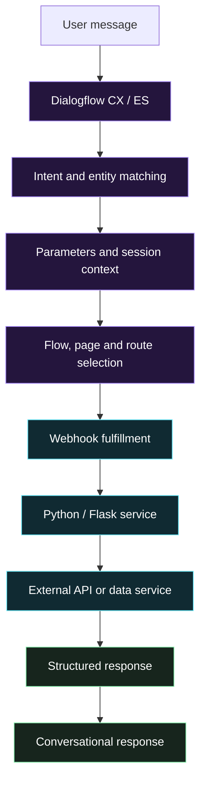

 <div align="center">


<br/>


<br/><br/>

<a href="https://www.linkedin.com/in/ujjwal-jagtap"></a>
<a href="https://github.com/Ujje421"></a>
<a href="mailto:ujjwaljagtap7@gmail.com"></a>

<br/><br/>


<br/><br/>

**I build conversational experiences and the backend systems that power them.**

<sub>Dialogflow CX / ES · Python · REST APIs · Google Cloud</sub>

</div>

---

## `01` / Engineering profile

I'm a Software Engineer at Sarvajna Media, working across conversational AI, backend integrations, and cloud-connected applications.

My focus is on building virtual-agent workflows that do more than understand user intent: they collect the right information, follow the right conversation path, call backend services, and return useful responses.

I work across the boundary between **conversation design and backend engineering** — from Dialogflow flows, pages, intents, and parameters to Python webhook handlers and API integrations.

```python
class UjjwalJagtap:
    role = "Software Engineer"
    location = "Nashik, India"

    primary_domains = [
        "Conversational AI",
        "Python Backend Engineering",
        "API & Webhook Integrations",
        "Cloud-Connected Applications",
    ]

    core_stack = [
        "Dialogflow CX / ES",
        "Python",
        "Flask",
        "REST APIs",
        "Google Cloud",
    ]

    product_work = [
        "Pretail Commerce",
        "Patrimony",
    ]

    engineering_principle = (
        "Make complex systems understandable, "
        "integrated, and reliable."
    )
```

<div align="center">


<table>
<tr>
<td align="center" width="33%">

### AI

**Conversational systems**

<sub>Intents · Entities · Context · Routing</sub>

</td>
<td align="center" width="33%">

### PYTHON

**Backend services**

<sub>Webhooks · REST APIs · Validation</sub>

</td>
<td align="center" width="33%">

### CLOUD

**Service integrations**

<sub>Google Cloud · Deployment · Data</sub>

</td>
</tr>
</table>

</div>

## `02` / Conversational AI engineering

<div align="center">


</div>

### From user intent to backend execution



### Areas of engineering

- **Dialogflow CX / ES:** intents, entities, parameters, session context, flow and page routing, transitions, and fulfillment.
- **Agent migration and maintenance:** conversational logic migration, flow restructuring, debugging, and integration fixes.
- **Python fulfillment:** webhook handlers, request/response processing, service integrations, and backend business logic.
- **API integration:** structured payloads, HTTP requests, validation, error handling, and external service connectivity.
- **Cloud integration:** deploying and connecting application services using Google Cloud tooling where appropriate.

### Professional project experience

<details>
<summary><b>Healthcare virtual agent</b> — Dialogflow CX and backend integrations</summary>

A healthcare virtual-agent project involving conversational workflows for scheduling, billing, laboratory services, clinical care, insurance, payments, and information requests.

Engineering areas include:

- Organizing conversation flows, pages, and routing.
- Collecting and handling contextual parameters.
- Integrating fulfillment services with backend operations.
- Maintaining consistent conversational behavior across workflows.

**Technology:** Dialogflow CX, Python/Flask, REST APIs, MySQL, Google Cloud.

</details>

<details>
<summary><b>Waste Management Agent</b> — Conversational workflow engineering</summary>

Professional work involving a waste-management conversational agent and associated application integrations.

Use this section to document the actual flows, fulfillment services, API integrations, and implementation details that can be shared publicly.

**Technology:** Dialogflow, Python/backend integrations, and relevant cloud services.

</details>

<sub>Professional experience is summarized at a high level. Proprietary source code, customer data, internal architecture, and confidential implementation details are intentionally excluded.</sub>

## `03` / Python & backend engineering

<div align="center">


### BEHIND EVERY INTELLIGENT WORKFLOW IS A SERVICE THAT MUST WORK.

</div>

My backend focus is on the services connecting AI agents, application workflows, and external systems.

| Engineering area | Focus |
|---|---|
| API development | REST endpoints, request/response contracts, structured JSON |
| Webhook fulfillment | Intent parameters, session data, fulfillment responses |
| Application logic | Validation, conditional workflows, service orchestration |
| Integration | HTTP clients, external APIs, database connectivity |
| Reliability | Exception handling, useful logs, predictable failure responses |
| Cloud | Service deployment, configuration, and connectivity |

### Core backend stack

<div align="center">


</div>

**Python:** Primary backend language for webhook services, integrations, and API-oriented development.

**Flask:** Lightweight web services and webhook fulfillment.

**FastAPI:** API development and continued exploration of modern Python service patterns.

**Node.js:** Backend application development and integration work.

**Databases:** MySQL, SQLite, Firestore, and other technologies as applicable to individual projects.

**Cloud:** Google Cloud, Cloud Run, Cloud Functions, and Firebase where appropriate to the implementation.

---

## `04` / Featured products

<div align="center">


### PRODUCTS I'M BUILDING

</div>

### `01` Pretail Commerce

**Commerce operations / Multi-tenant software**

A commerce operations platform for local-business use cases, with a focus on tenant-aware application workflows and maintainable software architecture.

**Engineering focus**

- Multi-tenant application behavior and business-profile isolation.
- Commerce workflows and operational interfaces.
- Frontend/backend integration and data consistency.
- Application performance and maintainability.

`React` `TypeScript` `TanStack Query` `Tailwind CSS` `Firebase`


### `02` Patrimony

**Digital assets / Documents / Nominee information**

A web and mobile product for organizing personal assets, important documents, and nominee information.

**Engineering focus**

- Asset and document management workflows.
- Authentication and access-control considerations.
- Web and mobile application development.
- Reliable data handling and user-facing workflows.

`Node.js` `React` `Firebase` `Flutter`


---

## `05` / Technology landscape

<div align="center">

### LANGUAGES


### BACKEND & APPLICATIONS


### CLOUD & INFRASTRUCTURE


### DATA & DEVELOPER TOOLS


</div>

**AI application development:** Dialogflow CX/ES, webhook fulfillment, NLU, RAG concepts, LLM application patterns, and LangChain.

**Architecture and systems:** REST API design, service integration, caching, event-driven architecture concepts, and system design.

<sub>Icons indicate technologies associated with my work and learning. They do not imply equal depth of experience or production use in every technology.</sub>

---

## `06` / GitHub analytics

<div align="center">

### ACTIVITY / CODE / CONSISTENCY


<br/><br/>


</div>

<sub>Statistics are generated by external services and may be delayed, unavailable, or subject to their own calculation rules. Language statistics do not measure engineering proficiency.</sub>

---

## `07` / Contribution graph

<div align="center">


</div>

<sub>Setup required: configure a GitHub Actions workflow in the profile repository to generate the contribution snake SVG and publish it to the `output` branch. Until configured, this image will not appear.</sub>

---

<div align="center">


### LET'S BUILD SOMETHING MEANINGFUL.

**Conversational AI · Python Backend · Cloud-Connected Systems**

<a href="https://www.linkedin.com/in/ujjwal-jagtap"></a>
<a href="mailto:ujjwaljagtap7@gmail.com"></a>

<br/>

<sub>Build thoughtfully. Ship reliably. Keep learning.</sub>

</div>
